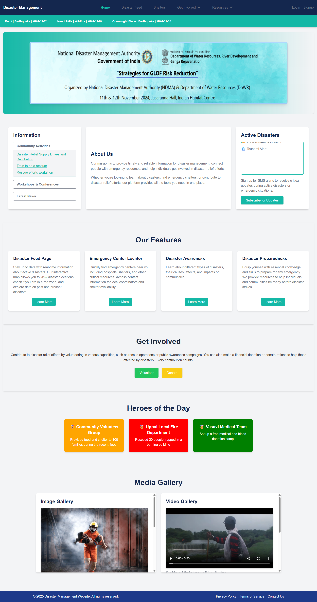
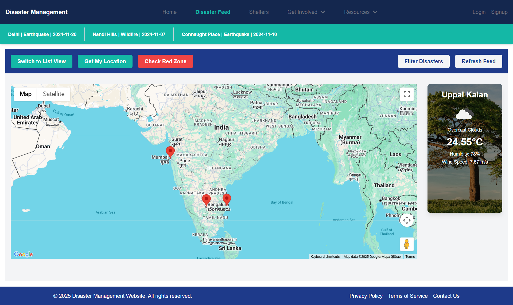
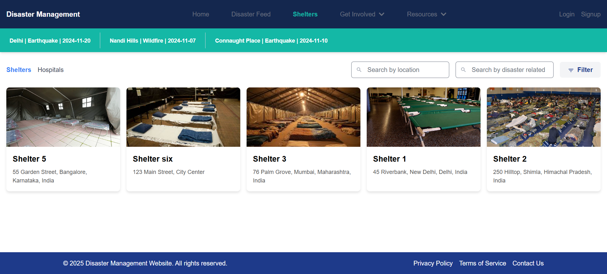
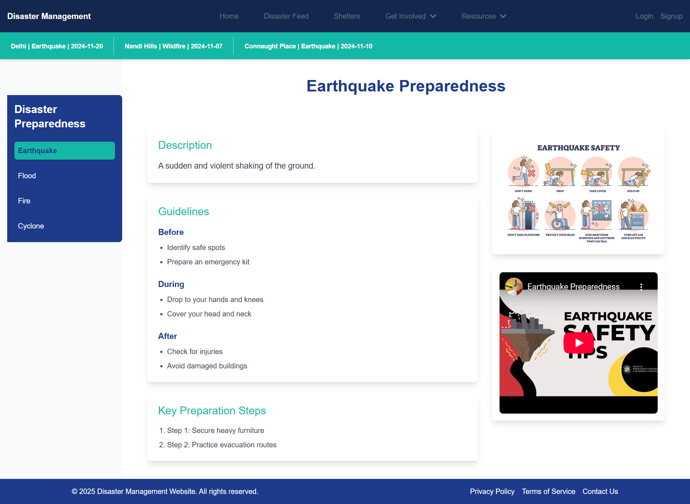
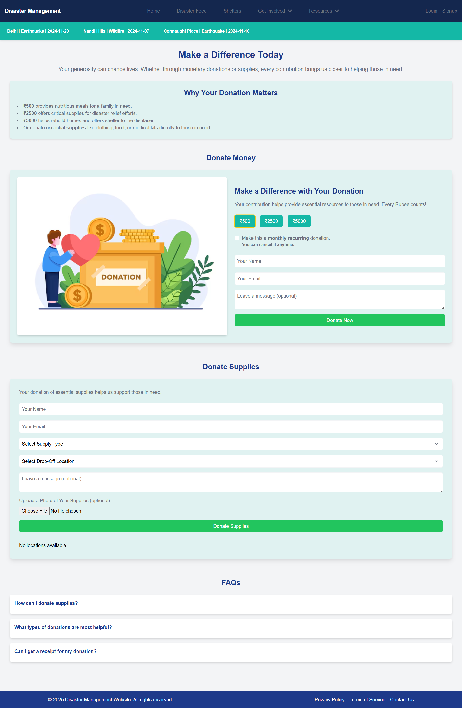
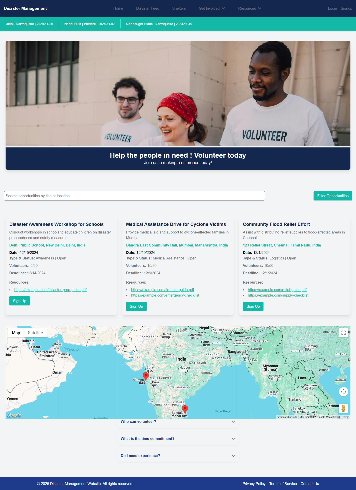

# Disaster Management

## Project Overview

Disaster Management is a comprehensive platform designed to facilitate and coordinate relief efforts during crisis situations. It provides tools for users, volunteers, coordinators, and administrators to manage disaster information, resources, and communication effectively. The application leverages real-time data visualization on maps, role-based access control, and various third-party integrations for donations and alerts.

## Features

*   **Role-Based Access Control:** Differentiated access and functionalities for users, volunteers, coordinators, and administrators.
*   **Interactive Disaster Maps:** Real-time visualization of disaster-affected areas, updates, shelters, and hospitals using the Google Maps API.
*   **Shelter and Hospital Locator:** Users can find nearby shelters and hospitals on an interactive map.
*   **Volunteer Coordination:** Manage volunteering activities, allowing users to sign up for opportunities and coordinators to manage them.
*   **Donation System:** Secure donation processing facilitated through the PayPal API.
*   **Supply Donations:** Functionality for donating essential supplies with drop-off location management.
*   **Real-time SMS Alerts:** Instant notifications and alerts sent via SMS (e.g., using Fast2SMS API - *integration to be confirmed based on actual implementation*).
*   **Weather Data Integration:** Display relevant weather information using APIs like OpenWeather API (*integration to be confirmed based on actual implementation*).
*   **Disaster Feed & Updates:** Centralized feed for ongoing and new disaster events.
*   **Preparedness & Awareness Information:** Resources and guides for disaster preparedness and awareness.

## Technologies and Libraries Used

### Backend

*   **Runtime/Framework:** Node.js, Express.js
*   **Database:** MongoDB with Mongoose ODM
*   **Authentication:** JSON Web Tokens (JWT), bcrypt
*   **File Storage:** Multer, GridFS (for MongoDB)
*   **APIs & SDKs:** PayPal Checkout Server SDK
*   **Utilities:** `axios`, `cors`, `dotenv`, `sanitize-html`
*   **Dev Tools:** `nodemon`

### Frontend

*   **Framework/Library:** React.js (with Vite)
*   **State Management:** Redux, Redux Toolkit, Redux Persist
*   **Routing:** React Router DOM
*   **Styling:** Tailwind CSS, Material-UI (MUI), Emotion
*   **HTTP Client:** Axios
*   **Mapping:** `@react-google-maps/api`
*   **Forms:** Formik, Yup
*   **UI Components/Utils:** Heroicons, React Icons, React Fast Marquee, React Slick, React Toastify, File Saver, Framer Motion
*   **Dev Tools:** ESLint, Vite

## Code Structure

The project is organized into two main directories: `frontend` and `backend`.

### `backend/`

Contains the Node.js and Express.js server-side application.

*   `config/`: Configuration files for database connection (MongoDB), environment variables (`dotenv.js`), PayPal, etc.
*   `controllers/`: Logic to handle incoming API requests and interact with models.
*   `middlewares/`: Custom middleware functions (e.g., `authMiddleware.js` for authentication).
*   `models/`: Mongoose schemas defining the structure of data in MongoDB (e.g., `User.js`, `Disaster.js`, `Donation.js`).
*   `routes/`: Defines the API endpoints and maps them to controller functions.
*   `services/`: (If any) Business logic separated from controllers.
*   `utils/`: Utility functions.
*   `index.js`: The main entry point for the backend server, initializes Express app and connects to the database.

### `frontend/`

Contains the React client-side application.

*   `public/`: Static assets like images and `index.html` template.
*   `src/`: The main source code for the React application.
    *   `api/`: Service functions for making API calls to the backend.
    *   `assets/`: Static assets like SVGs used within components.
    *   `components/`: Reusable UI components used across different pages.
    *   `contexts/`: React Context API for global state management (if used).
    *   `hooks/`: Custom React hooks.
    *   `pages/`: Top-level components representing different views/pages of the application.
    *   `redux/`: Redux store configuration, reducers (slices), and actions.
    *   `services/`: Contains functions for interacting with backend APIs (e.g., `disasterService.js`).
    *   `styles/`: Global styles or theme configurations.
    *   `App.jsx`: The root component of the React application, sets up routing.
    *   `main.jsx`: The entry point for the React application, renders the `App` component.

## Installation and Setup

### Prerequisites

*   Node.js (v14.x or higher recommended)
*   npm (comes with Node.js)
*   MongoDB (ensure a MongoDB instance is running)

### Steps

1.  **Clone the repository:**
    ```bash
    git clone <your-repository-url>
    cd Disaster-Management
    ```

2.  **Setup Backend:**
    ```bash
    cd backend
    npm install
    ```
    Create a `.env` file in the `backend/` directory and add the necessary environment variables. See the "Environment Variables" section below.

3.  **Setup Frontend:**
    ```bash
    cd ../frontend
    npm install
    ```
    Create a `.env` file in the `frontend/` directory and add the necessary environment variables. See the "Environment Variables" section below.

### Environment Variables

You need to create `.env` files in both the `backend` and `frontend` directories.

**`backend/.env` (Example):**
```env
PORT=5000
MONGODB_URI=mongodb://localhost:27017/disaster_management_db
JWT_SECRET=your_jwt_secret_key
PAYPAL_CLIENT_ID=your_paypal_client_id
PAYPAL_CLIENT_SECRET=your_paypal_client_secret
# Add any other backend-specific variables (e.g., Fast2SMS API key, OpenWeather API key if used directly in backend)
```

**`frontend/.env` (Example):**
```env
VITE_API_URL=http://localhost:5000/api
VITE_GOOGLE_MAPS_API_KEY=your_google_maps_api_key
# Add any other frontend-specific variables
```
**Note:** Replace placeholder values with your actual keys and configuration.

## How to Run the Project

1.  **Run the Backend Server:**
    Navigate to the backend directory and run:
    ```bash
    cd backend
    npm run dev
    ```
    The backend server will typically start on `http://localhost:5000` (or the port specified in your `backend/.env`).

2.  **Run the Frontend Application:**
    Navigate to the frontend directory and run:
    ```bash
    cd frontend
    npm run dev
    ```
    The frontend development server will typically start on `http://localhost:3000` (or the port specified by Vite, check your terminal output).

3.  **Run Both Concurrently (from the root directory):**
    The project's root `package.json` is configured to run both frontend and backend concurrently:
    ```bash
    npm start
    ```
    This command will execute `npm run dev:frontend` and `npm run dev:backend` simultaneously.

## API Routes

The backend exposes the following main API routes (prefixed with `/api`):

*   `/auth`: User authentication (login, signup).
*   `/disasters`: CRUD operations for disaster events.
*   `/shelters`: CRUD operations for shelter information.
*   `/hospitals`: CRUD operations for hospital information.
*   `/uploads`: File upload handling.
*   `/preparedness`: Disaster preparedness information.
*   `/awareness`: Disaster awareness information.
*   `/donations`: Handling financial donations (e.g., PayPal).
*   `/supplyDonations`: Handling supply donations.
*   `/dropOffLocations`: Managing drop-off locations for supplies.
*   `/homepage`: Data for the homepage.
*   `/subscribe`: Newsletter or alert subscriptions.
*   `/volunteer-opportunities`: Managing volunteer opportunities.
*   `/notifications`: Handling notifications.
*   `/volunteer-profile`: Managing volunteer profiles.
*   `/reports`: Generating or accessing reports.
*   `/team-communications`: Team communication features.
*   `/settings`: User or application settings.

Refer to the files in `backend/routes/` for detailed endpoint definitions and HTTP methods.

## Screenshots

### Home Page


### Disaster Feed


### Shelters Page


### Preparedness Page


### Donation Page


### Volunteers Page


## License

This project is licensed under the **MIT License**. See the `LICENSE` file for more details (you will need to create a `LICENSE` file with the MIT license text).
